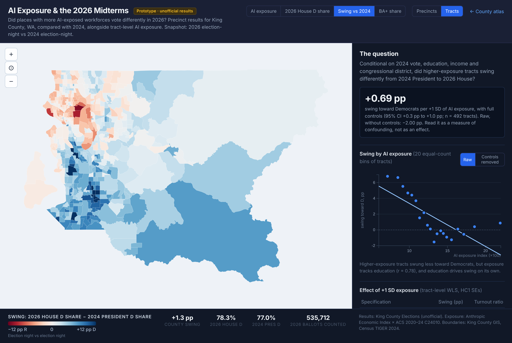

# Election Overlay (2026 Midterms): Tried and Shelved

*Nov 7, 2026. Unofficial election-night results.*

**Question.** Did places with more AI-exposed workforces vote differently in the 2026 midterms?

## 1. What we did

- **Geography.** King County, WA was the only place with precinct CSVs for both 2024 and 2026
  plus boundary files on election night. No national precinct file exists yet.
- **Exposure.** Built a **national census-tract** version of the Bartik index (85,382 tracts)
  from ACS 2020–24 C24010, with BA+ share and median income as controls. This part is kept:
  `src/pipeline/06_tract_exposure.py` → `data/processed/tract_exposure.parquet`.
- **Outcome.** Swing = 2026 US House D two-party share − 2024 Harris two-party share. Both years
  use the election-night count. 2024 House can't be the baseline because CD-9 was D-vs-D.
- **Method.** Area-weighted crosswalks between precincts and tracts. Weighted least squares on
  about 492 tracts (the unit where exposure is measured), with HC1 standard errors.

| Swing toward D per +1 SD of exposure | Estimate (SE) |
|---|---|
| No controls | −2.00 pp (0.18) |
| + BA+ share | +1.24 pp (0.19) |
| + log income, 2024 D share, congressional district | +0.69 pp (0.18) |

## 2. The visualization

The interactive version (precinct or tract units, four layers, raw vs. controlled scatter) was
**not merged**. It lives at commit `065b319` on branch `claude/adoring-allen-5w039k`, together
with the download and analysis scripts (`07_download_elections.py`, `08_election_overlay.py`).
To view it, check out that commit, run `cd src/map && python -m http.server`, and open
`elections.html`.

## 3. Why this isn't interesting (yet)

- **Exposure ≈ education.** Across tracts, exposure correlates **r = 0.78** with BA+ share, and
  BA+ share alone correlates r = −0.79 with swing. The sign flip in the table is confounding,
  not an AI effect. With collinearity that high and a noisy education control, even the +0.69
  can't be read causally.
- **The wave's geography drowns everything.** The national environment was about D+12. A uniform
  wave would cancel out of a cross-place comparison, but this one wasn't uniform. Most likely
  (untested), places that moved toward Trump in 2024 (less educated, working-class suburbs)
  snapped back hardest. In King
  County, south-county tracts swung several points toward D and parts of Seattle swung slightly
  toward R. That pattern runs opposite to exposure.
- **Wrong test bed.** One deep-blue county (2026 House D 78%, countywide swing +1.3 pp) offers
  little variation, and its exposure and education are especially tightly linked.
- **Wrong level.** These are places, not people. "Perceived AI threat" is a survey question. The
  2026 voter polls asked about AI in general and about data centers, not about AI and the
  respondent's own job.

**If we revisit.** Control for the 2020→2024 shift to absorb the snapback. Add counties where
exposure and education diverge (back-office and call-center towns). Better still, use
individual data: link the occupations of Cooperative Election Study respondents to occupation
exposure, and push for an own-job AI question in 2028 exit polls.
