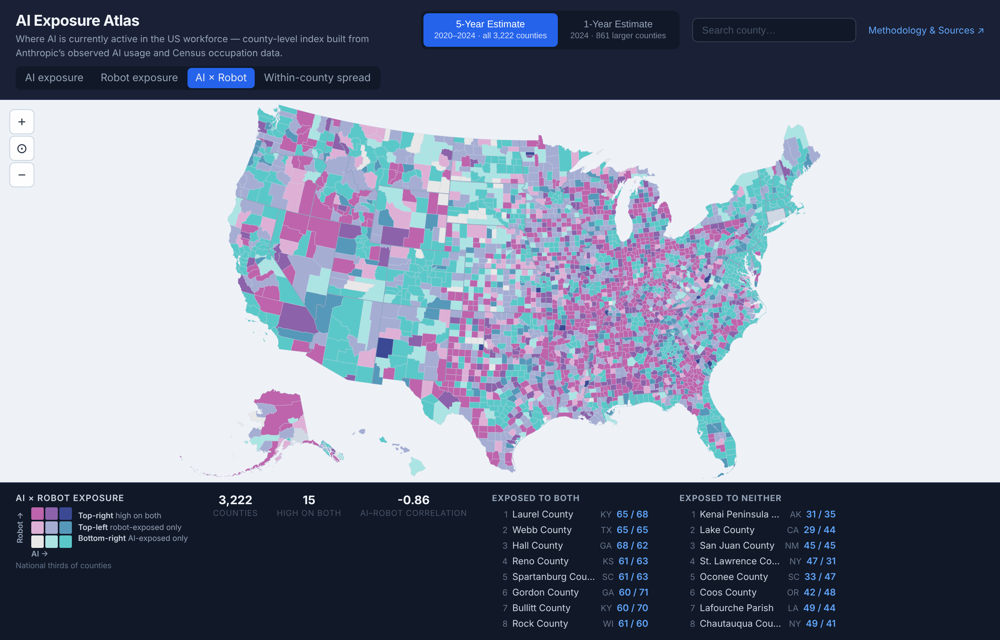
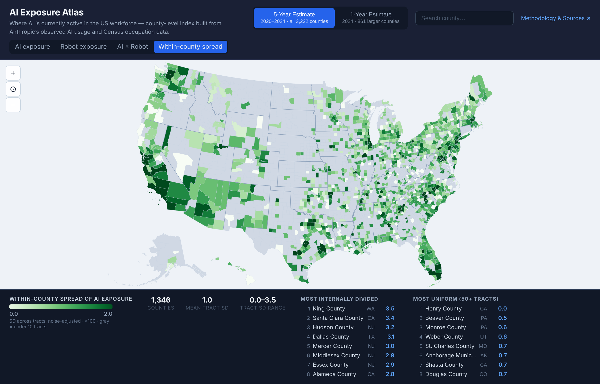

# Robot Exposure Layer and Within-County Spread

*Nov 7, 2026. Two analyses on how exposure differs across places, now layers on the main map.*

## 1. AI × Robot: places face one kind of automation or the other

**What we did.** We built a **Robot Exposure Index** with the same Bartik construction as the
AI index. It uses Anthropic's robot-exposure scores ("What work can robots do?", Sept 30 2026):
each occupation's physical tasks are rated 0–3 by how unstructured an environment a cited robot
can already work in. There are 798 SOC-6 codes, mapped to the 25 ACS groups. Script:
`src/pipeline/07_robot_exposure.py`.

**Finding.** AI exposure and robot exposure are close to **mirror images** geographically.

| | AI vs. robot correlation | Top third on *both* |
|---|---|---|
| Occupations (n = 756) | −0.39 | — |
| 25 ACS groups | −0.57 | — |
| Counties (n = 3,222) | **−0.86** | 15 counties, **0.05% of workers** |
| Counties with 25k+ workers (n = 937) | — | **0** (closest: Laurel KY, Webb TX, Hall GA, around the 63rd–68th percentiles on both) |
| Census tracts (n ≈ 84k) | −0.85 | 0.4% of workers |

- **Teal** (AI only): metros, suburbs and college towns.
- **Pink** (robot only): agricultural, manufacturing and logistics counties, concentrated in
  the South, the Midwest and the interior West.
- The "high on both" cell is nearly empty, even at the tract level.

**Is this real?** Mostly, yes. Randomly reassigning robot scores to occupation groups gives a
county correlation of 0 on average (SD 0.36). So −0.86 isn't built into the method. Two things
amplify it, though:
- Aggregating occupations to 25 groups strengthens the opposition (−0.39 → −0.57).
- County workforces vary mainly along one white-collar/blue-collar axis, which scales the
  group-level correlation up by about 1.3×.

Within a group like office/admin support, some jobs are exposed to both. A broad group can't
show that.

**Why it matters.** "Automation exposure" is not one map. The policy audience for AI exposure
(white-collar metros) and the audience for robot exposure (production, logistics, agriculture)
are almost entirely different places. A single combined "automation risk" index would average
these two away.

## 2. Within-county spread: the county map hides most of the variation

**What we did.** We split the worker-weighted variance of tract-level exposure into a
between-county part and a within-county part. Tract estimates are noisy, so we first removed
each tract's ACS sampling variance, estimated from the C24010 margins of error with the delta
method. Script: `src/pipeline/08_geographic_variance.py`.

| Share of tract variance that is *within* counties | AI | Robot |
|---|---|---|
| All tracts (raw → noise-adjusted) | 66% → **58%** | 73% → **69%** |
| Counties with 500k+ workers | 76% | 83% |
| 100k–500k | 67% | 76% |
| 25k–100k | 56% | 65% |
| Under 25k | 34% | 44% |

- **For most workers, the county map is a coarse summary.** In large metros, three-quarters or
  more of the variation in exposure lies between neighborhoods within the county.
- **Most internally divided on AI:** King WA, Santa Clara CA, Hudson NJ, Dallas TX, Mercer NJ,
  Middlesex NJ, Essex NJ, Alameda CA.
- **Most internally divided on robots:** Union NJ, Dallas TX, Mercer NJ, Monterey CA (farmland
  vs. coast), Essex NJ, Harris TX, Hudson NJ, Santa Barbara CA.
- **Small counties can't be measured.** In counties with five or fewer tracts, sampling noise
  exceeds the measured spread 68% of the time. The map grays out counties with fewer than 10
  tracts.

## Caveats

- **Noise adjustment is approximate.** It ignores covariance between ACS cells, so the 58%
  could be off by a few points either way.
- **Robot scores are unweighted means within groups**, matching the published AI index. With
  national-employment weights (ACS B24114 mapped to SOC, since `bls.gov` blocks automated
  downloads), the county correlation is −0.80 and 29 counties (0.2% of workers) are high on
  both. The conclusion doesn't change. The weighted AI index ranks counties almost identically
  to the published one (rank r = 0.97), but it moves some groups a lot: office/admin rises from
  19 to 36. Switching the headline index is a separate decision.
- **Physical ≠ cognitive automation timing.** Robot scores are based on systems that are
  already deployed or demonstrated, including demos. AI scores reflect observed Claude usage.
  The two indices measure different stages of adoption.

## Not yet done (analysis 3, on hold)

Find places that are exposed but poorly placed to adapt. Analysis 2 suggests doing this at the
**tract** level within metros rather than across counties. Analysis 1 suggests doing it
separately for AI and for robot exposure, since the two hit different places and different
populations.
