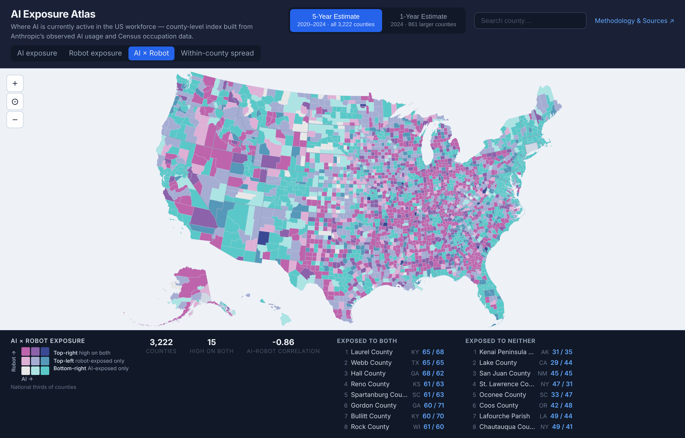

# AI vs. Robot Exposure: Findings on Current Data

*Nov 7, 2026. Builds on [05_robot_layer_and_geographic_spread.md](05_robot_layer_and_geographic_spread.md).
Numbers come from `src/pipeline/09_robot_findings.py` → `data/processed/robot_findings.json`.
Updated Nov 8, 2026: Puerto Rico excluded (50 states + DC, as on the map); figures recomputed.*

AI exposure and robot exposure fall on almost entirely different places and people. Both indices
use the same Bartik construction: Anthropic Economic Index occupation scores (AI usage; robot
task exposure, Sept 2026), weighted by ACS 2020–24 5-year workforce shares in 25 occupation groups.

## Headline numbers

| Measure | Value |
|---|---|
| AI vs. robot exposure, counties (n = 3,144) | Correlation: −0.86 |
| AI vs. robot exposure, census tracts (n ≈ 83k) | Correlation: −0.85 |
| Workers in counties top third on both | 0.05% of all US workers (14 counties) |
| Workers in counties top third AI, bottom third robot | 72% of all US workers (820 counties) |
| Workers in counties top third robot, bottom third AI | 6% of all US workers (793 counties) |
| Exposure vs. share of adults with a BA, tracts | Correlation: AI +0.76, robot −0.86 |
| Richest vs. poorest income fifth of tracts | AI: 1.47×; robot: 0.54× |
| Production jobs, robot-heavy vs. AI-heavy counties | 11% vs. 4% of workers |

**Reading the correlations.** A correlation runs from −1 to +1. At −0.86, a county that ranks
high on AI exposure almost always ranks low on robot exposure, and the reverse. The tract figure
shows the same pattern holds at the neighborhood level. Randomly reassigning robot scores to
occupation groups gives a county correlation near zero (see 05), so this is not built into the method.

**Workers vs. land.** Thirds are by county count, as on the map legend. The robot-heavy corner
holds a quarter of counties but 6% of workers. The AI-heavy corner holds a similar number of
counties but 72% of workers. Shaded by county, robots look like the bigger story; counted by
people, AI is.

**Income and education.** Ranking tracts by median household income, worker-weighted AI exposure
rises steadily from the poorest fifth (0.084) to the richest (0.123), 47% higher. Robot exposure
falls from 0.507 to 0.275, so the poorest fifth is 84% higher. The share of adults with a
bachelor's degree tracks both, more strongly for robots.

| Income fifth (tract median household income) | AI exposure | Robot exposure |
|---|---|---|
| 1 (~$44k) | 0.084 | 0.507 |
| 2 (~$62k) | 0.089 | 0.467 |
| 3 (~$77k) | 0.096 | 0.425 |
| 4 (~$98k) | 0.106 | 0.368 |
| 5 (~$140k) | 0.123 | 0.275 |

**What drives the split.** Production work is the largest single difference between the two
county types (11% vs. 4% of workers), followed by material moving, construction, farming and
repair. On the AI side the gap comes from business/finance, management and computer/math jobs.

**Places.** Among counties with 100k+ workers, the most AI-exposed are Arlington VA, Loudoun VA,
Forsyth GA, Fairfax VA, Washington DC, Collin TX, San Francisco and Santa Clara. The most
robot-exposed are Merced, Tulare, Stanislaus, Kern, San Joaquin and Monterey in California, plus
Yakima WA and Clayton GA. By state, DC, Maryland, Virginia, New Jersey, Colorado and Massachusetts
lead on AI; Mississippi, Indiana and Kentucky are near the bottom on AI and near the top on robots.

## Caveats

- Group scores are unweighted means over SOC codes. With employment weights the county
  correlation is −0.80; the conclusions hold (see 05).
- AI scores reflect observed Claude usage; robot scores reflect deployed or demonstrated systems.
  Neither is a forecast of job loss.
- 2020–24 is the newest 5-year ACS. The 2021–25 release (expected around Dec 2026) is the next
  refresh; 1-year data has no tracts.
